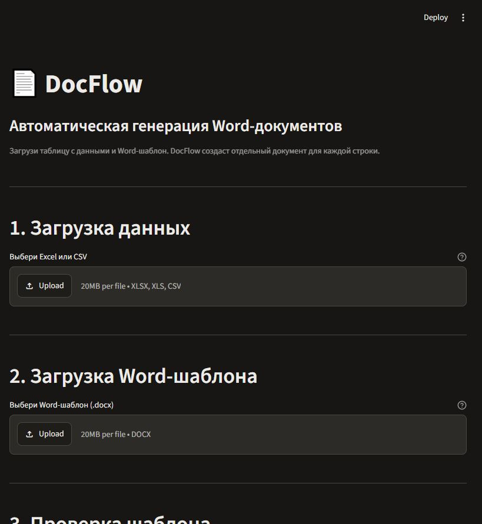

# DocFlow

**Пакетное создание документов Word из Excel и CSV.**

DocFlow берёт данные из строк таблицы, подставляет их в DOCX-шаблон и собирает готовые документы в ZIP-архив. Это локальное приложение на Python: файлы обрабатываются на компьютере пользователя.

## Возможности

- Загружает таблицы CSV, XLS и XLSX и шаблоны DOCX.
- Находит переменные в шаблоне и проверяет, что для них есть столбцы в таблице.
- Показывает предварительный просмотр таблицы.
- Создаёт отдельный DOCX для каждой строки и упаковывает документы в ZIP.
- Позволяет нумеровать файлы автоматически или использовать значения выбранного столбца.
- Очищает имена файлов и разрешает совпадения, добавляя порядковые номера.
- Ведёт ограниченный журнал работы без содержимого загруженных документов.

## Как это работает

1. Подготовьте таблицу с заголовками столбцов и DOCX-шаблон.
2. Добавьте в Word-шаблон переменные, например `{{ name }}`.
3. Загрузите оба файла в DocFlow и проверьте предварительный просмотр и найденные переменные.
4. Выберите правило именования, создайте документы и скачайте ZIP-архив.

## Демонстрация

В репозитории есть готовые файлы `demo_clients.csv` и `demo_template.docx`. Загрузите их в приложение, чтобы проверить весь сценарий без подготовки собственных данных. Примеры в таблице вымышленные; результатом будет архив с двумя DOCX-файлами.



Снимок сделан в работающем приложении DocFlow. Для проверки генерации используйте демонстрационные файлы из репозитория.

## Технологии

- Python 3.12 или 3.13
- Streamlit — интерфейс приложения
- pandas, openpyxl и xlrd — чтение таблиц
- docxtpl и python-docx — заполнение и создание документов Word
- pytest — автоматические тесты

## Установка и запуск

### Windows

1. Установите Python 3.13 с Python Launcher.
2. Запустите `install.bat`. Он создаст виртуальное окружение и установит зависимости приложения.
3. Запустите `start.bat`. Приложение откроется в браузере на этом компьютере.

### Linux и macOS

Из корневой папки проекта выполните:

```bash
python3.12 -m venv .venv
.venv/bin/python -m pip install -r requirements.txt
.venv/bin/python -m streamlit run app.py
```

Для остановки приложения нажмите `Ctrl+C` в окне, где оно запущено.

## Тестирование

Для запуска тестов установите зависимости разработчика:

```powershell
.\.venv\Scripts\python.exe -m pip install -r requirements-dev.txt
$env:PYTHONDONTWRITEBYTECODE = "1"
.\.venv\Scripts\python.exe -m pytest -p no:cacheprovider -v
.\.venv\Scripts\python.exe scripts\check_syntax.py
.\.venv\Scripts\python.exe -m pip check
```

GitHub Actions автоматически запускает эти проверки на Windows, Ubuntu и macOS
с Python 3.12 и 3.13. Это контроль качества исходного кода; приложение на
сервер не разворачивается.

Linux и macOS:

```bash
.venv/bin/python -m pip install -r requirements-dev.txt
PYTHONDONTWRITEBYTECODE=1 .venv/bin/python -m pytest -p no:cacheprovider -v
.venv/bin/python scripts/check_syntax.py
.venv/bin/python -m pip check
```

## Безопасность и ограничения

- Файлы обрабатываются локальным приложением. Входные документы не отправляются во внешние API, а их содержимое не записывается в журнал.
- Приложение рассчитано на одного пользователя и запуск на своём компьютере. В нём нет учётных записей и входа по паролю; не открывайте его в публичную сеть без отдельной настройки доступа.
- Размер каждого загружаемого файла — до 20 МБ; таблица — до 500 непустых строк.
- Распакованный размер таблицы и шаблона ограничен 100 МБ. Суммарный размер DOCX до сжатия — до 100 МБ; размер ZIP-архива — до 100 МБ.
- Поддерживаются `.csv`, `.xls`, `.xlsx` и `.docx`. Форматы `.doc`, `.docm`, PDF и макросы не поддерживаются.
- Формулы Excel не вычисляются: используются сохранённые в книге значения.
- Переменная шаблона должна находиться в одном непрерывном фрагменте текста Word. Если Word разбил её форматированием на части, DocFlow может её не распознать.
- Генерация и архивирование выполняются в памяти. Лимиты ограничивают объём
  входа и результата, но не гарантируют работу на любой машине при дефиците
  свободной памяти.
- `.xls` читается через `xlrd`. Формулы Excel не вычисляются, а сложная
  структура Word и переменные, разбитые форматированием, имеют ограничения.
  Проверьте несколько результатов перед обработкой всего пакета.

## Частые проблемы

- **Не найдены переменные.** Используйте `{{ name }}` и убедитесь, что имя
  совпадает с заголовком столбца.
- **Файл не читается.** Проверьте расширение, сохраните CSV в UTF-8 или
  Windows-1251 и убедитесь, что шаблон — настоящий DOCX, а не DOC/DOCM.
- **Сервер не открывается.** Проверьте, что установка завершилась и порт 8501
  свободен, затем повторите запуск.
- **Архив слишком велик.** Разделите таблицу на пакеты до 500 строк.

## Лицензия и вклад

Репозиторий опубликован для просмотра без предоставления лицензии на повторное
использование, изменение или распространение проекта. См. [LICENSE](LICENSE).
Правила предложений и сообщений об уязвимостях: [CONTRIBUTING.md](CONTRIBUTING.md)
и [SECURITY.md](SECURITY.md).

## Структура проекта

```text
app.py                    интерфейс приложения
app/reader.py             чтение и проверка таблиц
app/generator.py          создание DOCX и ZIP
app/config.py             лимиты файлов и строк
app/logger.py             журнал работы
tests/                    автоматические тесты
demo_clients.csv          демонстрационная таблица
demo_template.docx        демонстрационный шаблон
install.bat, start.bat    установка и запуск в Windows
check.bat                 запуск проверок в Windows
requirements*.txt         зависимости приложения и тестов
scripts/check_syntax.py   проверка синтаксиса Python
.github/workflows/ci.yml  автоматические проверки на GitHub
```
